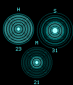

# Petrichor

A native Pebble watchface. Three raindrops turn a puddle into a clock.



[](https://apps.repebble.com/dea9d54d1da8492c91596cd0) [](LICENSE)

H marks the hour, M the minute and S the second. Twelve standing rings around
each drop fill as its value increases, and small numbers give the exact local
hour, minute and second.

The second drop makes a small splash every second. The minute adds a larger,
slower splash at each new minute, and the hour sends out the largest wave at
the top of each hour. The waves spread through the other gauges and fade.

The drops sit in a triangle on round and rectangular screens: hour at the
upper left, second at the upper right, minute below. Color watches use cyan
rings on black. Monochrome watches use solid filled rings, dotted empty rings,
and a partial arc for part of a ring.

The face updates once a second. Tap your wrist for about six seconds of
smoother ripples at eight frames a second; leaving the face stops it early.
There are no settings, and the face needs no phone connection, account or
network access.

## Watches

| Platform | Watch | Display |
| --- | --- | --- |
| basalt | Pebble Time, Time Steel | 144 × 168, color |
| chalk | Pebble Time Round | 180 × 180, color, round |
| diorite | Pebble 2 | 144 × 168, monochrome |
| emery | Pebble Time 2 | 200 × 228, color |
| flint | Pebble 2 Duo | 144 × 168, monochrome |
| gabbro | Pebble Round 2 | 260 × 260, color, round |

## Install

Get Petrichor 1.0.0 from the
[Pebble Appstore](https://apps.repebble.com/dea9d54d1da8492c91596cd0).
[release/petrichor-1.0.0.pbw](release/petrichor-1.0.0.pbw) is the same
version, with its source ZIP and SHA-256 checksums.

## Build and test

Use Pebble SDK 4.33.1 and a host C compiler (Clang by default). Normal builds
use the checked-in resources. Python 3 with Pillow regenerates the menu icon
(`make assets`). The face has no external font or library dependencies.

```sh
make test
pebble build --sdk 4.33.1
```

Pebble names the output after the project directory: in a directory named
`petrichor`, it is `build/petrichor.pbw`. The source ZIP holds the project at
its root and builds on its own.

The emulator scripts need the Python environment that has `pebble-tool`. Run
each platform before packaging:

```sh
python test/emulator.py basalt --fresh
python test/emulator.py chalk --fresh
python test/emulator.py diorite --fresh
python test/emulator.py emery --fresh
python test/emulator.py flint --fresh
python test/emulator.py gabbro --fresh
python test/package.py
python test/independent.py --pebble pebble
```

Each capture uses a fresh emulator profile. The checks cover installation,
logs, changing seconds, natural noon and midnight rollovers, a wrist tap, and
the return to one update per second. Packaging verifies each platform's
application and resource CRC, the metadata and the evidence hash.
[evidence/README.md](evidence/README.md) describes the results. Build logs in
earlier commits contain absolute paths from the original build machine.

## How the port works

I made the original [Petrichor](https://datapoems.io/clocks/petrichor/) as a
web clock. Its HTML and a screenshot are in `reference/`, and
[provenance.json](reference/provenance.json) records their hashes.

The port keeps the twelve-ring gauges, the 24-hour mapping, three splash
sizes, three spreading speeds, quadratic fades and three trailing crests per
wave. Ripple ages come straight from the local clock, so a face that resumes
shows the waves that belong to that moment without replaying missed drops. At
most six waves are alive at once. Host tests compare 691,200 time samples with
the source equations and check gauge values and label bounds.

The triangle layout leaves room for all three gauges and their labels. Gauge
radius is 17% of the shorter screen dimension on round screens and 20.5% on
rectangular ones. Small bitmap digits replace the browser font.

On color screens, cyan brightness steps replace translucent strokes and blur,
and the faint water gradient becomes black. Monochrome screens use sparse dots
to tell passing crests from the standing gauges. The browser's continuous
animation becomes one-second samples plus the tap animation. At one update a
second, the second splashes repeat the same pattern each time; the second
gauge still advances, and minute and hour waves keep spreading.

The package UUID is `4150a96f-88c8-48cd-ad81-74a1fc34c8c7`. Keep it unchanged
for updates.

## License

Copyright 2026 Luke Steuber. [MIT License](LICENSE). No third-party fonts,
images or code are bundled.
